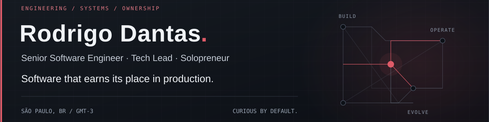
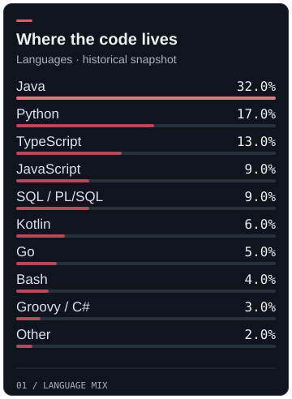
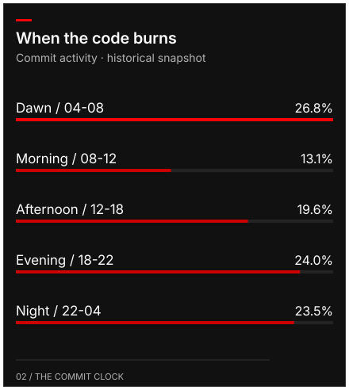
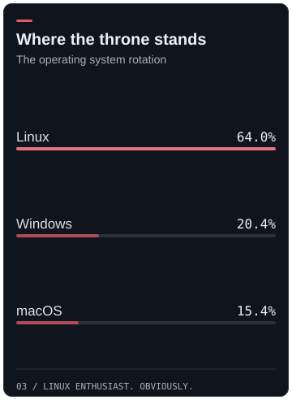
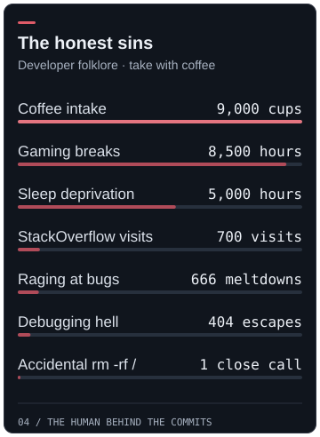

São Paulo · GMT-3 · Portuguese native · English fluent · Spanish advanced

[Experience](#experience) · [Projects](#user-content-projects) · [Engineering](#user-content-engineering) · [HustleTech](#user-content-hustletech) · [Education](#user-content-education--speaking) · [Connect](#user-content-connect) · [Holocrons](#user-content-holocrons--by-the-numbers)

## Experience

[Full career details →](https://hustletech.dev/about-me#experience)

<table width="100%">
<tr>
<td width="9999"> &nbsp; <strong>Fiserv</strong> · Senior Software Engineer, Operations · via Go2Win · Oct 2024 - Present 
Banking and compliance APIs, incident investigation and LLM-assisted triage · Java · Python · Splunk · OpenShift</td>
</tr>
<tr>
<td width="9999"> &nbsp; <strong>KIS Solutions</strong> · Senior Software Engineer · Sep 2022 - Sep 2024 
Full-stack web and mobile delivery, technical direction and CDC/ETL pipelines · Java · Python · React Native · PostgreSQL</td>
</tr>
<tr>
<td width="9999"> &nbsp; <strong>Metal Toad</strong> · Senior Software Engineer · Jun 2021 - Aug 2022 
Software for US clients and event-driven integrations across services · Java/Spring · Python · React · RabbitMQ</td>
</tr>
<tr>
<td width="9999"> &nbsp; <strong>Banco BV</strong> · Senior Software Developer · via Opah · Apr 2021 - May 2021 
Backend and integration services for a retail bank, on shared banking infrastructure · Java/Spring · Apache Camel · Redis · PostgreSQL</td>
</tr>
<tr>
<td width="9999"> &nbsp; <strong>Via Varejo (Casas Bahia)</strong> · Technical Lead · May 2020 - Apr 2021 
Led digital insurance embedded in retail checkout, from issuance to signatures · Java/Spring · Node.js · MongoDB · Azure</td>
</tr>
<tr>
<td width="9999"> &nbsp; <strong>UOL</strong> · Senior Software Developer · via Opah · Oct 2019 - May 2020 
Payment, antifraud and subscription services with Java and Camel integrations · Java · Kotlin · Quarkus · Apache Camel</td>
</tr>
<tr>
<td width="9999"> &nbsp; <strong>CVC</strong> · Senior Java Developer · via Opah · Mar 2019 - Sep 2019 
Airline-sales backend and Kafka pipelines from Oracle to MongoDB · Java/Spring · Kafka · Oracle · MongoDB</td>
</tr>
<tr>
<td width="9999"> &nbsp; <strong>Transire (ITBAM)</strong> · Software Developer · Jul 2018 - Feb 2019 
Food delivery and checkout-free retail products, including RFID billing · Java/Spring · Node.js · Angular · RFID</td>
</tr>
<tr>
<td width="9999"> &nbsp; <strong>Tap4 Mobile</strong> · Software Developer · Sep 2016 - Jun 2018 
CRM dashboards, incident-monitoring screens and Android applications · PHP · Node.js · Java · Angular</td>
</tr>
</table>

<h2></h2>

Code, experiments and roadmap. Repository links include implementation details.

<table width="100%">
<tr><td width="9999">
<strong><a href="https://github.com/napalm23zero/llm-gateway">LLM Gateway ↗</a></strong> · Public experiment · Benchmarks in progress 
Semantic caching with correctness safeguards, streaming, routing and fallback · Python · FastAPI · PostgreSQL / pgvector · Redis · SSE
</td></tr>
<tr><td width="9999">
<strong><a href="https://github.com/napalm23zero/lab-event-driven-orders-platform">Event-Driven Orders Platform ↗</a></strong> · Public lab 
SAGA, Outbox and CDC for order processing, with observability and AWS infrastructure · Kafka · Debezium · PostgreSQL · OpenTelemetry · Grafana · Terraform
</td></tr>
<tr><td>
<strong>Distributed Systems Playground</strong> · In progress 
Reference architectures for event sourcing, CQRS and saga orchestration · Java · Spring · Kafka · PostgreSQL
</td></tr>
<tr><td>
<strong>Opinionated Backend Starter</strong> · Coming soon 
A backend foundation for authentication, observability, CI/CD and multi-tenancy · NestJS · TypeScript · Docker · GCP
</td></tr>
<tr><td>
<strong>LLM Agent Reference Stack</strong> · Coming soon 
A reference stack for tool calling, evals, fallbacks and cost controls · Python · FastAPI · LangChain · Vector DBs
</td></tr>
<tr><td>
<strong>Edge + Cloud IoT Stack</strong> · Planned 
An edge-to-cloud reference stack connecting devices and cloud services · ESP32 · Python · GCP IoT · MQTT
</td></tr>
</table>

<h2></h2>

Architecture shaped by constraints: modular monoliths, microservices, event-driven systems, CDC/ETL and multi-tenant SaaS. Hands-on leadership with teams across the Americas and Europe. Coding assistants support the work; engineering judgment stays with me.

Core stack: Java · Spring · Python.

<table width="100%">
<tr><td><strong>Languages</strong></td><td width="9999">        </td></tr>
<tr><td><strong>Web &amp; APIs</strong></td><td width="9999">      </td></tr>
<tr><td><strong>Cloud &amp; delivery</strong></td><td width="9999">         </td></tr>
<tr><td><strong>Data &amp; messaging</strong></td><td width="9999">          </td></tr>
<tr><td><strong>AI &amp; ML</strong></td><td width="9999">       </td></tr>
<tr><td><strong>Systems &amp; IoT</strong></td><td width="9999">     </td></tr>
</table>

<h2></h2>

**From problem to production.**

**Founder & sole engineer · 2016 - Present.** I start with the problem, decide what is worth building and own the path from architecture to operations. At HustleTech, meetings between departments are quick. I just switch tabs.

3 apps · 2 games · Built outside business hours alongside my engineering career

<table width="100%">
<tr><td><strong>Condo</strong> B2B · In development</td><td width="9999">Condominium management, connecting operators and residents. Multi-tenant SaaS · Tenant isolation · Plans and access control</td></tr>
<tr><td><strong>Ardha Arcana</strong> B2C · In development</td><td width="9999">Tarot, learning and community in one product. Single-tenant · User-centric entitlements · Shared platform foundation</td></tr>
</table>

Java/Spring · React & React Native · GCP Cloud Run · PostgreSQL · Redis · Terraform · GitHub Actions  
**[Inside HustleTech →](https://hustletech.dev/about)** · [Products & partnerships →](https://hustletech.dev/studio)

<h2></h2>

**Learn. Build. Share.**

<table width="100%">
<tr><td><strong>Education</strong> 2023 - 2026</td><td width="9999"><strong>B.Sc. Computer Science</strong> · Universidade Estácio, São Paulo Jan 2023 - Dec 2026 (expected) · Building toward Senior Software Architect</td></tr>
<tr><td><strong>Talk</strong> 2021</td><td width="9999"><strong>MongoDB: What Problems Does It Actually Solve?</strong> Universidade Estácio · Choosing a database around the problem</td></tr>
<tr><td><strong>Talk</strong> 2020</td><td width="9999"><strong>Best Practices in RESTful API Development with Node.js and Swagger</strong> Universidade Estácio · API design, implementation and documentation</td></tr>
</table>

[Education, languages & certificates →](https://hustletech.dev/about-me#foundations)

<h2></h2>

Engineering roles, technical conversations and cofounder discussions.  
**[Email](mailto:rodrigo.dantas@hustletech.dev)** · **[Book a call](https://calendar.app.google/R4jWYVHJgZodVK147)** · [LinkedIn](https://www.linkedin.com/in/dantas-rodrigo) · [Website](https://hustletech.dev/) · [Medium](https://medium.com/@napalm23zero) · [Dev.to](https://dev.to/napalm23zero) · [X](https://twitter.com/napalm23zero)

<h2></h2>

 

Languages: five-year snapshot · OS: current estimate · Coffee, gaming and debugging: developer folklore. Historical commit-time percentages total 107% and are preserved as recorded.

 

Stay curious. Own the tradeoffs. Ship things that matter.

