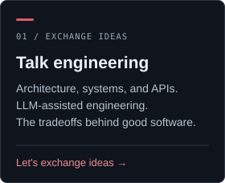
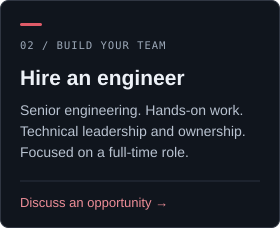
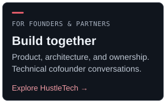

<div align="center">


<br>

**Java & Spring · Python · Distributed systems · Product engineering**

[LinkedIn](https://www.linkedin.com/in/dantas-rodrigo) &nbsp; / &nbsp; [HustleTech](https://hustletech.dev/) &nbsp; / &nbsp; [Email](mailto:rodrigo.dantas@hustletech.dev) &nbsp; / &nbsp; [Book a conversation](https://calendar.app.google/R4jWYVHJgZodVK147)

</div>

<br>

<p align="center">
<a href="mailto:rodrigo.dantas@hustletech.dev?subject=Let%27s%20talk%20engineering"></a>
<a href="mailto:rodrigo.dantas@hustletech.dev?subject=Senior%20engineering%20opportunity"></a>
<a href="mailto:rodrigo.dantas@hustletech.dev?subject=Technical%20cofounder%20conversation"></a>
</p>

## About / the engineer behind the systems

I'm **Rodrigo Dantas**, a Senior Software Engineer, Tech Lead, and the founder of **HustleTech**. I've spent **10 years building software**, after five in systems analysis and infrastructure. That background helps me follow a failure from an API down to the mainframe, and translate what I find into a plan a team can ship.

My work spans **banking, fintech, regulatory compliance, retail, travel, insurtech, and SaaS** across Brazil and the US. Java, Spring, and Python are at the core; React, Next.js, and React Native come in when the problem calls for full-stack delivery.

**São Paulo, Brazil · GMT-3** &nbsp; / &nbsp; **Portuguese: native · English: fluent · Spanish: advanced**

<table>
<tr>
<td width="50%" valign="top">

**Systems that hold up**  
Microservices, modular monoliths, event-driven systems, CDC/ETL, and multi-tenant SaaS. Business constraints shape the architecture.

**Teams that keep growing**  
Technical leadership at Via Varejo and KIS Solutions. Mentored 3 juniors who progressed to mid-level, with PR reviews alongside senior architects.

</td>
<td width="50%" valign="top">

**Automation with judgment**  
LLM-assisted incident triage at FiServ; internal agents for testing, architecture review, vulnerability scanning, and code quality at HustleTech. People make the decisions.

**Engineering people can understand**  
Work with US and European teams, and clients in Mexico, Argentina, and Colombia. Connect stakeholder needs to practical implementation.

</td>
</tr>
</table>

## HustleTech / independent product building

<table>
<tr>
<td valign="top">

<sub>MY COMPANY · FOUNDER & SOLE ENGINEER · 2016 - PRESENT</sub>

### A company of one. An end-to-end engineering practice.

**HustleTech is my own company, where I build personal products as a solopreneur outside business hours. My full-time engineering role is my professional priority.**

I've independently developed **3 apps and 2 games**, from concept to implementation. Current platform work includes:

- **Condo** / A multi-tenant B2B SaaS for Brazilian condominium management.
- **Ardha** / A single-tenant B2C tarot platform.

Both platforms are in development. Java/Spring Boot modular monoliths on GCP Cloud Run, React and React Native, PostgreSQL, and Redis, with Terraform and GitHub Actions supporting delivery.

[Explore HustleTech →](https://hustletech.dev/)

<details>
<summary><b>Under the hood / architecture & ownership</b></summary>

Database-enforced tenancy constraints, Redis-backed RBAC, and an LGPD-aware identity model. LLM-powered agents assist testing, architecture review, vulnerability scanning, and code quality. Design, implementation, and delivery are part of the same ownership loop.

</details>

</td>
</tr>
</table>

## Career / engineering in production

The companies, the problems, and the work. My current position is **Senior Software Engineer, Operations at FiServ, via Go2Win**.

| Where | When | Work & impact |
|---|---|---|
| **FiServ** *(via Go2Win)* | Oct 2024 - Present | Banking and compliance APIs, end-to-end incident investigation, and LLM-assisted triage: average triage time reduced from ~60 to ~20 minutes. Human-reviewed decisions. |
| **KIS Solutions** | Sep 2022 - Sep 2024 | Full-stack delivery across 5 client projects, CDC/ETL pipelines, and mentoring within a team of 8. |
| **MetalToad** | Jun 2021 - Aug 2022 | US client projects and Salesforce-to-Java notification integration through RabbitMQ. |
| **Via Varejo (Casas Bahia)** *(via Opah)* | May 2020 - Apr 2021 | Technical leadership for digital insurance embedded in retail checkout, including policy issuance and digital signature. |
| **UOL** *(via Opah)* | Oct 2019 - May 2020 | Java and Apache Camel integrations for payments, UOL Mail, antivirus, and antifraud products. |
| **CVC** *(via Opah)* | Mar 2019 - Sep 2019 | Airline package sales backend and Kafka/ETL pipelines synchronizing Oracle with MongoDB. |
| **Transire (ITBAM)** | Jul 2018 - Feb 2019 | PedeJa food delivery in Java/Spring and Ghost Market checkout-free retail in Node.js with RFID. |
| **Tap4 Mobile** | Sep 2016 - Jun 2018 | CRM integrations, Angular dashboards, and incident monitoring with an Android app for Musashi. |

<details>
<summary><b>Career timeline</b></summary>

```text
PERIOD                  ROLE                                  COMPANY
──────────────────────  ────────────────────────────────────  ─────────────────────────────
Oct 2024 - Present      Senior Software Engineer, Operations  FiServ via Go2Win
Sep 2022 - Sep 2024      Senior Software Engineer              KIS Solutions
Jun 2021 - Aug 2022      Senior Software Engineer              MetalToad
May 2020 - Apr 2021      Technical Lead                        Via Varejo via Opah
Oct 2019 - May 2020      Senior Software Engineer              UOL via Opah
Mar 2019 - Sep 2019      Senior Java Developer                 CVC via Opah
Jul 2018 - Feb 2019      Software Developer                    Transire (ITBAM)
Sep 2016 - Jun 2018      Software Developer                    Tap4 Mobile
```

</details>

<details>
<summary><b>Earlier roles / integrations, travel, retail, and mobile</b></summary>

<br>

### Senior Software Engineer · UOL via Opah · `Oct 2019 - May 2020`

**São Paulo, Brazil**  
Supported payment services, UOL Mail, and online antivirus and antifraud products. Built and maintained Java and Apache Camel integrations, working with Kotlin, Quarkus, and TDD.

### Senior Java Developer · CVC via Opah · `Mar 2019 - Sep 2019`

**São Paulo, Brazil**  
Built the Java/Spring backend for airline package sales. An ETL/Kafka pipeline synchronized a saturated legacy Oracle database with MongoDB instances, directing frequent reads to MongoDB while retaining writes in Oracle.

### Software Developer · Transire (ITBAM) · `Jul 2018 - Feb 2019`

**São Paulo, Brazil**  
Developed **PedeJa**, a food-ordering and delivery platform in Java/Spring, and **Ghost Market**, a checkout-free store using Node.js and RFID to bill customers as they walked out.

### Software Developer · Tap4 Mobile · `Sep 2016 - Jun 2018`

**São Paulo, Brazil**  
Integrated CRM data for an events app, segmenting customers by age, peak days, and payment method in Angular 2 dashboards. Built incident-monitoring alert screens and an Android app for Musashi.

</details>

## Toolbox / the stack follows the problem

Backend work across Java, Spring, Python, Node.js, Kotlin, and C#; React, Next.js, and React Native for full-stack delivery. APIs, messaging, observability, and infrastructure connect the pieces.

<div align="center">

#### Languages

&nbsp;
&nbsp;
&nbsp;
&nbsp;
&nbsp;
&nbsp;
&nbsp;
&nbsp;


#### Backend, web & mobile

&nbsp;
&nbsp;
&nbsp;
&nbsp;
&nbsp;
&nbsp;


#### Cloud & delivery

&nbsp;
&nbsp;
&nbsp;
&nbsp;
&nbsp;
&nbsp;
&nbsp;
&nbsp;
&nbsp;


#### Data & integration

&nbsp;
&nbsp;
&nbsp;
&nbsp;
&nbsp;
&nbsp;
&nbsp;
&nbsp;
&nbsp;
&nbsp;


#### AI & machine learning

&nbsp;
&nbsp;
&nbsp;
&nbsp;
&nbsp;
&nbsp;
&nbsp;


#### Operating systems & hardware

&nbsp;
&nbsp;
&nbsp;
&nbsp;
&nbsp;


</div>

## The workshop / projects & experiments

Public experiments and reference stacks. **In progress and planned**, with delivery status kept explicit.

<table>
<tr>
<td width="50%" valign="top">

### Distributed Systems Playground
*(in forging)*

Reference architectures for the patterns I keep rebuilding: **event sourcing, CQRS, saga orchestration**. Production-grade. Tests, benchmarks, docs / *as the doctrine demands*.

`Java · Spring · Kafka · Postgres`

---

### Opinionated Backend Starter
*(coming soon)*

The template I wish I had a decade ago. Auth, observability, CI/CD, multi-tenancy / *all that a young apprentice should not have to learn the hard way*.

`NestJS · TypeScript · Docker · GCP`

</td>
<td width="50%" valign="top">

### LLM Agent Reference Stack
*(coming soon)*

Production patterns for LLM agents that survive contact with reality. Tool calling, evals, fallback strategies, cost controls. *Demos are not deployments.*

`Python · FastAPI · LangChain · Vector DBs`

---

### Edge + Cloud IoT Stack
*(planned)*

Because most "edge computing" tutorials end at *"blink an LED."* Mine will not.

`ESP32 · Python · GCP IoT · MQTT`

</td>
</tr>
</table>

#### Published / NestJS API template

[](https://github.com/napalm23zero/ultimate-typescript-nestjs-api-template)

## Beyond the code / learning & sharing

<table>
<tr>
<td width="50%" valign="top">

### Education & direction

**B.Sc. Computer Science**  
Universidade Estácio, São Paulo  
`Jan 2023 - Jun 2026`

Algorithms, data structures, operating systems, networks, and software engineering. Built applications in Java, Python, and C++.

Building toward **Senior Software Architect** through complex projects, continued learning, and certifications.

</td>
<td width="50%" valign="top">

### Speaking & writing

**2021** / *MongoDB: What Problems Does It Actually Solve?*  
Universidade Estácio

**2020** / *Best Practices in RESTful API Development with Node.js and Swagger*  
Universidade Estácio

Writing about LLM-assisted engineering, personal products, and the engineering decisions that matter.

[Medium →](https://medium.com/@napalm23zero) &nbsp; [Dev.to →](https://dev.to/napalm23zero)

</td>
</tr>
</table>

## Connect / good conversations build good things

Engineering conversations, full-time opportunities, or a thoughtful technical cofounder discussion. Tell me what you're building and where I could help.

**[rodrigo.dantas@hustletech.dev](mailto:rodrigo.dantas@hustletech.dev)**

[LinkedIn](https://www.linkedin.com/in/dantas-rodrigo) &nbsp; / &nbsp; [30-minute call](https://calendar.app.google/R4jWYVHJgZodVK147) &nbsp; / &nbsp; [HustleTech](https://hustletech.dev/) &nbsp; / &nbsp; [Twitter / X](https://twitter.com/napalm23zero)

<br>

## GitHub / the public signal

<div align="center">

<a href="https://github.com/napalm23zero">
  
  
</a>

<br><br>

<a href="https://git.io/streak-stats">
  
</a>

</div>

<p align="center">


</p>

## Holocrons / by the numbers

The terminal has a personality, too. A historical snapshot of the stack, the habits, and a little developer folklore.

<p align="center">


<br>


</p>

<details>
<summary><b>Open the holocron / original terminal view</b></summary>

```text
🩸  WHERE THE BLOOD IS SPILLED  ·  languages, last 5 years across all roles

   🟫 Java                  ████████████████░░░░░░░░░░░░░░   32.0%
   🐍 Python                ████████░░░░░░░░░░░░░░░░░░░░░░   17.0%
   🟦 TypeScript            ██████░░░░░░░░░░░░░░░░░░░░░░░░   13.0%
   🟨 JavaScript            ████░░░░░░░░░░░░░░░░░░░░░░░░░░    9.0%
   📊 SQL / PL/SQL          ████░░░░░░░░░░░░░░░░░░░░░░░░░░    9.0%
   🟪 Kotlin                ███░░░░░░░░░░░░░░░░░░░░░░░░░░░    6.0%
   🐹 Go                    ███░░░░░░░░░░░░░░░░░░░░░░░░░░░    5.0%
   🐚 Bash                  ██░░░░░░░░░░░░░░░░░░░░░░░░░░░░    4.0%
   🌀 Groovy / C#           ██░░░░░░░░░░░░░░░░░░░░░░░░░░░░    3.0%
   📝 Other                 █░░░░░░░░░░░░░░░░░░░░░░░░░░░░░    2.0%
```

```text
🌙  WHEN THE CODE BURNS  ·  commit distribution across the day

   🌅 Dawn      (04–08)    ████████░░░░░░░░░░░░░░░░░░░░░░   26.8%
   🌞 Morning   (08–12)    ████░░░░░░░░░░░░░░░░░░░░░░░░░░   13.1%
   🌆 Afternoon (12–18)    ██████░░░░░░░░░░░░░░░░░░░░░░░░   19.6%
   🌇 Evening   (18–22)    ████████░░░░░░░░░░░░░░░░░░░░░░   24.0%
   🌃 Night     (22–04)    ███████░░░░░░░░░░░░░░░░░░░░░░░   23.5%
```

```text
🖥️  WHERE THE THRONE STANDS  ·  operating systems

   🐧 Linux                ████████████████████░░░░░░░░░░   64.0%
   🪟 Windows              ██████░░░░░░░░░░░░░░░░░░░░░░░░   20.4%
   🍏 macOS                █████░░░░░░░░░░░░░░░░░░░░░░░░░   15.4%
```

```text
🩸  THE HONEST SINS  ·  less serious

   🥤 Coffee Intake         ██████████████████████████████   9,000 cups
   🎮 Gaming Breaks         ████████████████████████░░░░░░   8,500 hours
   💤 Sleep Deprivation     ██████████████░░░░░░░░░░░░░░░░   5,000 hours
   🐱 StackOverflow Visits  █████░░░░░░░░░░░░░░░░░░░░░░░░░     700 visits
   🤬 Raging at Bugs        ████░░░░░░░░░░░░░░░░░░░░░░░░░░     666 meltdowns
   🐛 Debugging Hell        ██░░░░░░░░░░░░░░░░░░░░░░░░░░░░     404 escapes
   💀 Accidental rm -rf /   █░░░░░░░░░░░░░░░░░░░░░░░░░░░░░       1 near-death exp
```

</details>

<br>

<p align="center"><sub>Stay curious. Own the tradeoffs. Ship things that matter.</sub></p>
